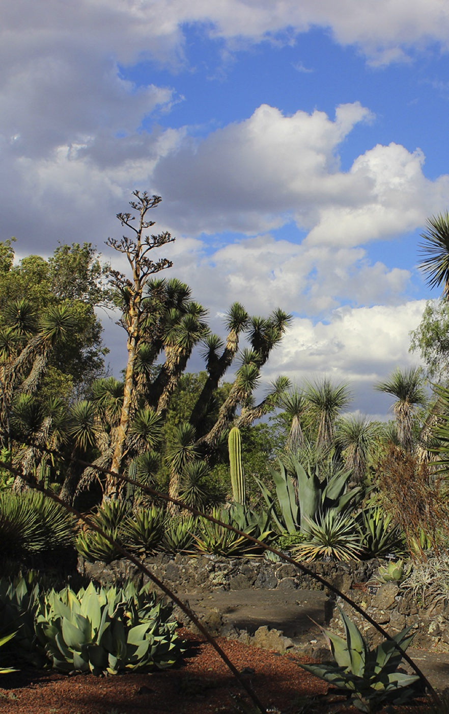
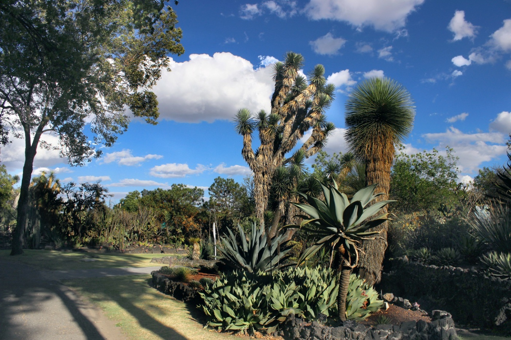
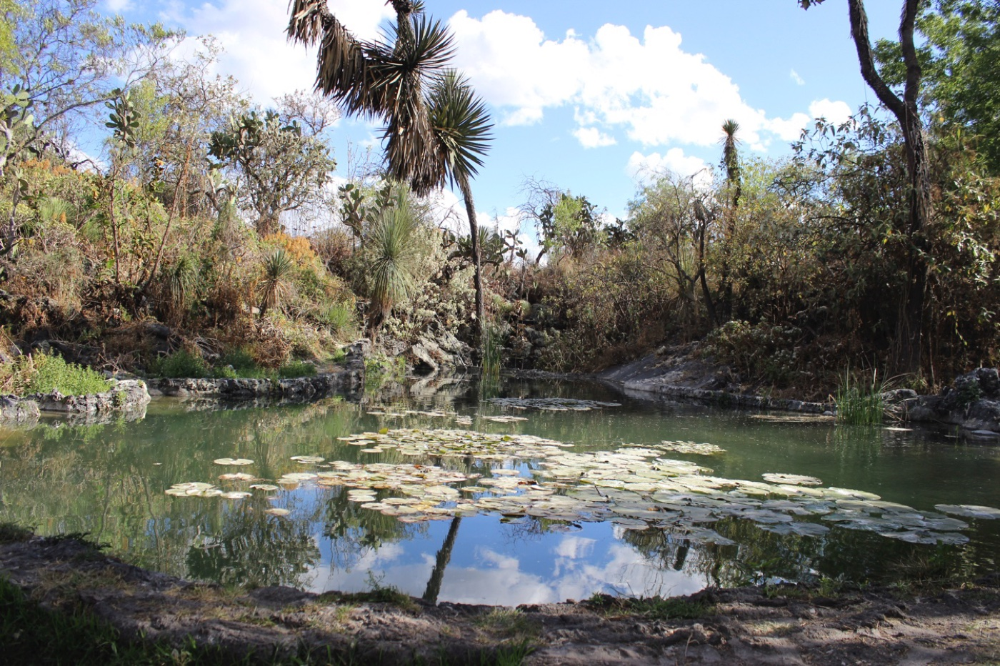
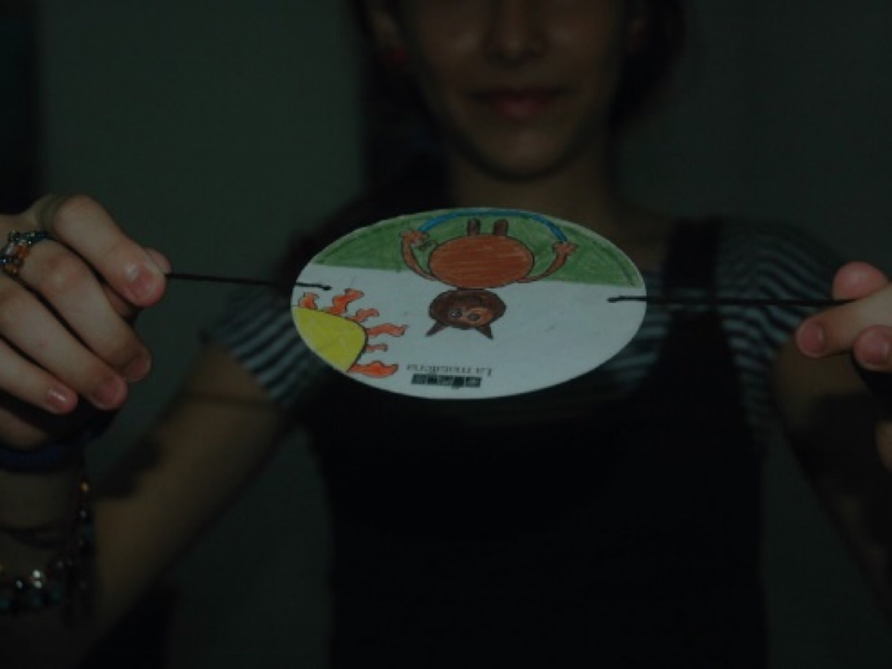

## En este boletín

- **[La cartelera de noviembre](/cartelera/noviembre-2026/):** teatro, danza, ciencia, talleres, la FILIJ y cine para todo el mes.
- **[Lecturas de la comunidad](/lecturas/lecturas-de-la-comunidad/):** [*Diario de un desenterrador de dinosaurios*](/lecturas/diario-de-un-desenterrador-de-dinosaurios/), recomendado por Lucía R., de 4º, y [*Sobrevive en: Una noche en el safari*](/lecturas/sobrevive-en-una-noche-en-el-safari/), recomendado por Darío V., de 2º.
- **Un espacio al aire libre:** el Jardín Botánico de la UNAM.
- **Cultura de paz:** el proyecto La Matatena.

## Recomendación: Jardín Botánico de la UNAM

*Por Tatiana C., mamá de Rodrigo, de 4º.*

El Jardín Botánico es un espacio abierto en el que podrás observar colecciones de distintas plantas, principalmente de México, que están a cargo del Instituto de Biología de la UNAM. Este instituto estudia la diversidad de plantas que hay en él y se encarga de su conservación. El objetivo es que el público visitante conozca una muestra de la riqueza vegetal del país. Es también un espacio muy importante para proteger la flora y la fauna que ahí habitan.

Es importante que sigas las reglas de cuidado: no arranques ninguna planta ni flor, no te lleves ningún elemento del jardín y camina únicamente por los andadores marcados.

- **Ubicación:** Ciudad Universitaria, Coyoacán. Circuito Zona Deportiva s/n. Puedes llegar en auto o en el Pumabús que sale del metro CU.
- **Horarios:** de lunes a viernes, de 9:00 a 17:00 h; sábados, de 9:00 a 15:00 h. Cierra los domingos, los días festivos y en vacaciones universitarias.
- **Costo:** entrada gratuita.

**¿Por qué nos gusta?** Es un espacio para conocer y contemplar la naturaleza, maravillarnos con las formas y los tamaños de las plantas, y también para reflexionar sobre el papel y la importancia de la naturaleza, sabiéndonos parte de ella. Los seres humanos somos un ser vivo más dentro de este amplio y complejo sistema. Envueltos en este espacio, uno puede pensar en la necesidad de cuidar todos los ecosistemas que existen, su flora y su fauna, desde lo más pequeño hasta el árbol más grande.

Si vas, ¿nos cuentas qué te pareció? Más información en [ib.unam.mx/ib/jb](https://www.ib.unam.mx/ib/jb/).

## Cultura de paz: el proyecto La Matatena

*Por Tania R., mamá de Teo N., de 6º.*

**La Matatena, A.C.** es una asociación de cine para niñas y niños creada para acercar a la población infantil a una cinematografía de calidad, con materiales realizados en México y en otras partes del mundo que se proyectan en el Festival Internacional de Cine para Niños (…y no tan Niños). Promueve que niñas y niños se acerquen a los medios audiovisuales de una manera creativa, con actividades culturales a lo largo del año y en el marco de su festival anual.

**¿Hacer cine y construir paz?** Ajá… Para esta organización, difundir y producir cine para niñas y niños, divertido, creativo y con valores humanos, promueve la participación ciudadana para formar públicos sensibles, reflexivos, críticos, comprometidos y que participen en la transformación de su entorno.

La Matatena hace posible que, año con año, llegue el cine de mejor calidad (ojo, que no es lo mismo que megaproducciones) para que niñas y niños hagan volar la imaginación y la esperanza conociendo cómo viven y piensan otras niñas y otros niños en el mundo. Además, apoya la difusión de contenidos que nos ayudan a pensar cómo se logra la paz y cómo se viven los derechos humanos.

Te invitamos a ver [*Niñez en Pajajté, Chiapas*](https://www.youtube.com/watch?v=4LSr9erYiGE), un corto que formó parte de uno de sus festivales. Lo hicieron niñas y niños de Chiapas que hablan tsotsil.

Conoce más en [lamatatena.org](https://www.lamatatena.org/inicio.html) y échale un vistazo a sus talleres y a su festival anual.
