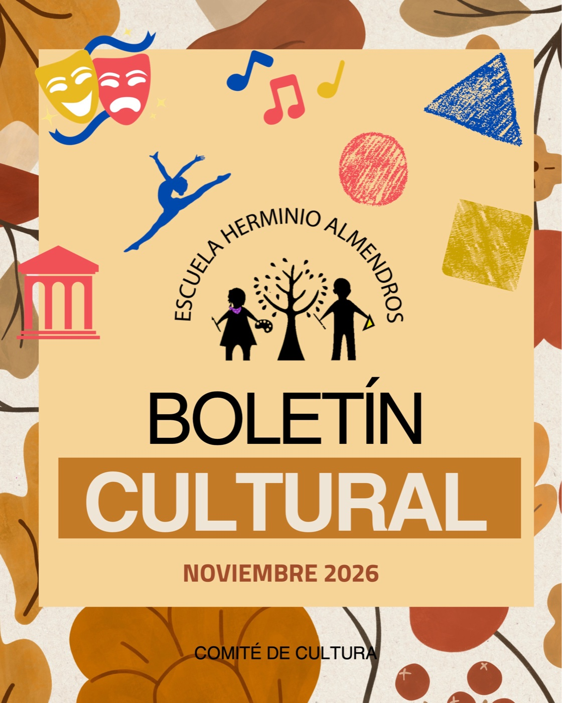

## En este boletín

- **[La cartelera de noviembre](/cartelera/noviembre-2026/):** teatro, danza, ciencia, talleres, la FILIJ y cine para todo el mes.
- **[Lecturas de la comunidad](/lecturas/lecturas-de-la-comunidad/):** [*Diario de un desenterrador de dinosaurios*](/lecturas/diario-de-un-desenterrador-de-dinosaurios/), recomendado por Lucía R., de 4º, y [*Sobrevive en: Una noche en el safari*](/lecturas/sobrevive-en-una-noche-en-el-safari/), recomendado por Darío V., de 2º.
- **[Un espacio al aire libre](/boletines/jardin-botanico-unam/):** el Jardín Botánico de la UNAM, recomendado por Tatiana C., mamá de Rodrigo, de 4º.
- **[Cultura de paz](/boletines/la-matatena/):** el proyecto La Matatena, presentado por Tania R., mamá de Teo N., de 6º.
