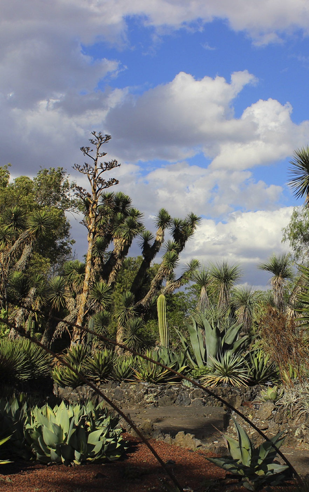
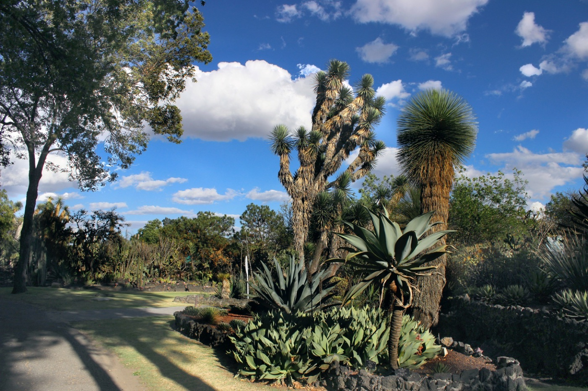
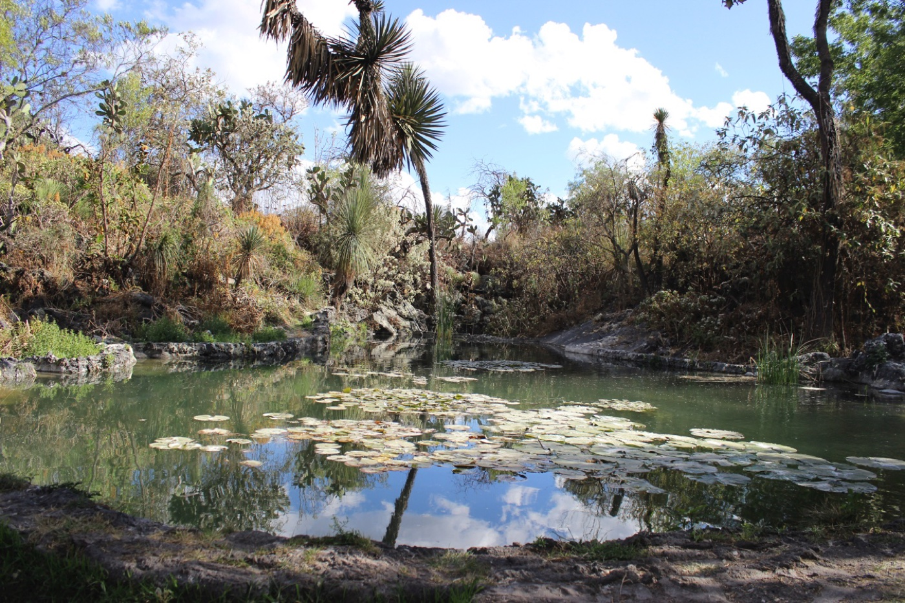

El Jardín Botánico es un espacio abierto en el que podrás observar colecciones de distintas plantas, principalmente de México, que están a cargo del Instituto de Biología de la UNAM. Este instituto estudia la diversidad de plantas que hay en él y se encarga de su conservación. El objetivo es que el público visitante conozca una muestra de la riqueza vegetal del país. Es también un espacio muy importante para proteger la flora y la fauna que ahí habitan.

Es importante que sigas las reglas de cuidado: no arranques ninguna planta ni flor, no te lleves ningún elemento del jardín y camina únicamente por los andadores marcados.

- **Ubicación:** Ciudad Universitaria, Coyoacán. Circuito Zona Deportiva s/n. Puedes llegar en auto o en el Pumabús que sale del metro CU.
- **Horarios:** de lunes a viernes, de 9:00 a 17:00 h; sábados, de 9:00 a 15:00 h. Cierra los domingos, los días festivos y en vacaciones universitarias.
- **Costo:** entrada gratuita.

**¿Por qué nos gusta?** Es un espacio para conocer y contemplar la naturaleza, maravillarnos con las formas y los tamaños de las plantas, y también para reflexionar sobre el papel y la importancia de la naturaleza, sabiéndonos parte de ella. Los seres humanos somos un ser vivo más dentro de este amplio y complejo sistema. Envueltos en este espacio, uno puede pensar en la necesidad de cuidar todos los ecosistemas que existen, su flora y su fauna, desde lo más pequeño hasta el árbol más grande.

Si vas, ¿nos cuentas qué te pareció? Más información en [ib.unam.mx/ib/jb](https://www.ib.unam.mx/ib/jb/).

*Recomendación de Tatiana C., mamá de Rodrigo, de 4º, para el [boletín de noviembre](/boletines/boletin-noviembre-2026/).*
