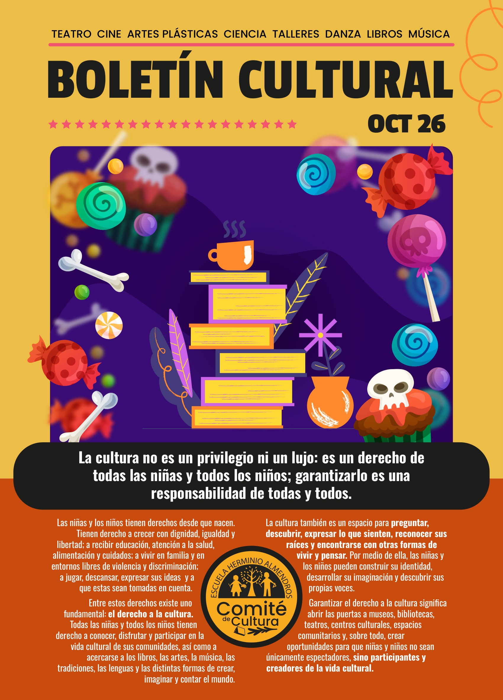
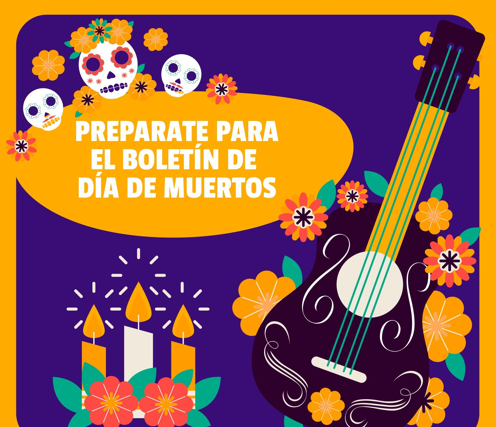

Las niñas y los niños tienen derechos desde que nacen. Tienen derecho a crecer con dignidad, igualdad y libertad; a recibir educación, atención a la salud, alimentación y cuidados; a vivir en familia y en entornos libres de violencia y discriminación; a jugar, descansar, expresar sus ideas y a que éstas se tomen en cuenta.

Entre estos derechos hay uno fundamental: el derecho a la cultura. Todas las niñas y todos los niños tienen derecho a conocer, disfrutar y participar en la vida cultural de sus comunidades, y a acercarse a los libros, las artes, la música, las tradiciones, las lenguas y las distintas formas de crear, imaginar y contar el mundo.

La cultura también es un espacio para preguntar, descubrir, expresar lo que sienten, reconocer sus raíces y encontrarse con otras formas de vivir y pensar. Por medio de ella, las niñas y los niños pueden construir su identidad, desarrollar su imaginación y descubrir sus propias voces.

Garantizar el derecho a la cultura significa abrir las puertas de museos, bibliotecas, teatros, centros culturales y espacios comunitarios. Y, sobre todo, crear oportunidades para que niñas y niños no sean únicamente espectadores, sino participantes y creadores de la vida cultural.

## En este boletín

- **[La cartelera de octubre](/cartelera/octubre-2026/):** cine, artes plásticas, música, teatro, danza y ciencia para todo el mes.
- **[Lecturas de la comunidad](/lecturas/lecturas-de-la-comunidad/):** *Gorila*, recomendado por Rodrigo Emilio, de 4.º, y *El libro de los cerdos* y *Cuando fuiste nube*, recomendados por Tatiana C.

## Prepárate para el boletín de Día de Muertos

Muy pronto llega un boletín especial dedicado al Día de Muertos.

## Quiénes hacemos el boletín

Comité de Cultura: Adriana H., Conetl S., Iván N., Mariana L., Montserrat C., Penélope H., Ricardo G., Sarai P., Talía G., Tania R., Tatiana C., Vania S. y Xanat V.
