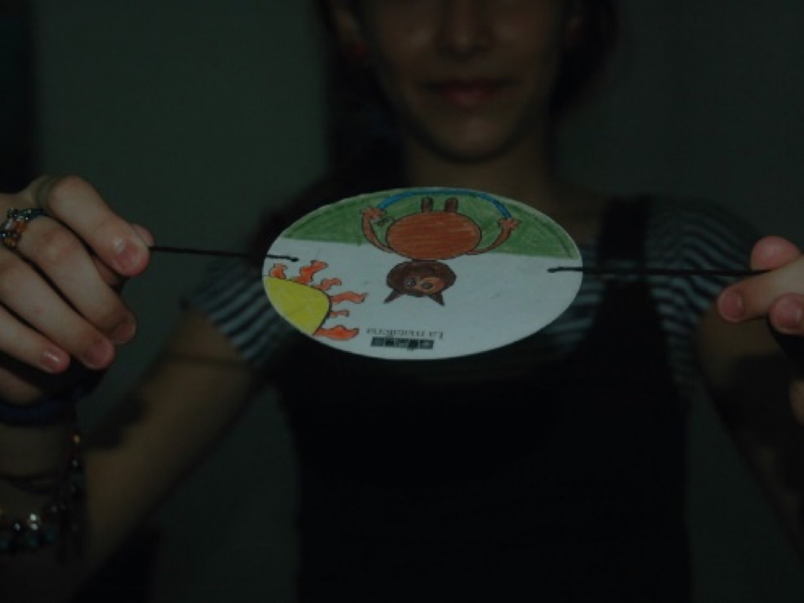

**La Matatena, A.C.** es una asociación de cine para niñas y niños creada para acercar a la población infantil a una cinematografía de calidad, con materiales realizados en México y en otras partes del mundo que se proyectan en el Festival Internacional de Cine para Niños (…y no tan Niños). Promueve que niñas y niños se acerquen a los medios audiovisuales de una manera creativa, con actividades culturales a lo largo del año y en el marco de su festival anual.

**¿Hacer cine y construir paz?** Ajá… Para esta organización, difundir y producir cine para niñas y niños, divertido, creativo y con valores humanos, promueve la participación ciudadana para formar públicos sensibles, reflexivos, críticos, comprometidos y que participen en la transformación de su entorno.

La Matatena hace posible que, año con año, llegue el cine de mejor calidad (ojo, que no es lo mismo que megaproducciones) para que niñas y niños hagan volar la imaginación y la esperanza conociendo cómo viven y piensan otras niñas y otros niños en el mundo. Además, apoya la difusión de contenidos que nos ayudan a pensar cómo se logra la paz y cómo se viven los derechos humanos.

Te invitamos a ver [*Niñez en Pajajté, Chiapas*](https://www.youtube.com/watch?v=4LSr9erYiGE), un corto que formó parte de uno de sus festivales. Lo hicieron niñas y niños de Chiapas que hablan tsotsil.

Conoce más en [lamatatena.org](https://www.lamatatena.org/inicio.html) y échale un vistazo a sus talleres y a su festival anual.

*Texto de Tania R., mamá de Teo N., de 6º, para el [boletín de noviembre](/boletines/boletin-noviembre-2026/).*
