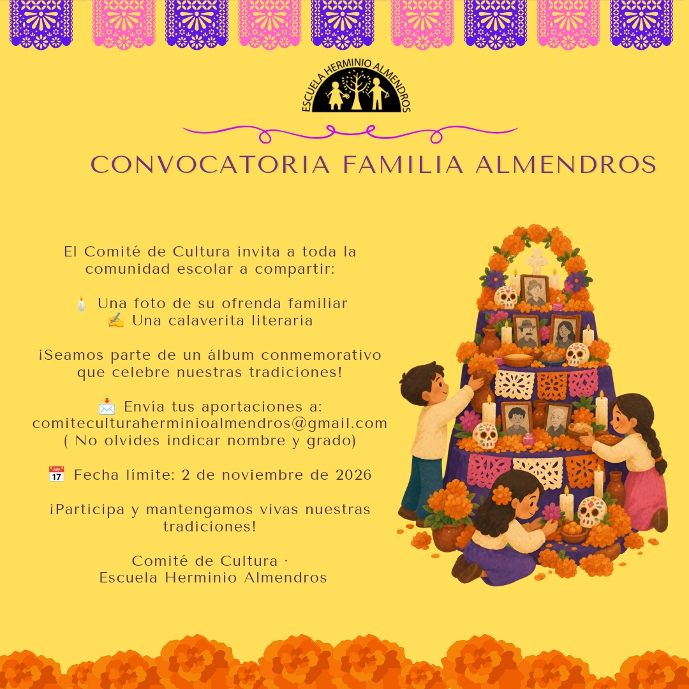

El Comité de Cultura invita a toda la comunidad escolar, niñas, niños, mamás, papás y familias, a compartir dos cosas:

- **Una foto de su ofrenda familiar.**
- **Una calaverita literaria**, escrita por ustedes.

Con lo que nos manden armaremos un álbum conmemorativo aquí mismo, en esta página, para que mantengamos vivas nuestras tradiciones.

## Cómo participar

Envía tus aportaciones a [comiteculturaherminioalmendros@gmail.com](mailto:comiteculturaherminioalmendros@gmail.com?subject=Ofrendas%20y%20calaveritas%202026&body=Nombre%3A%20%0AGrado%3A%20%0A%0A%C2%BFAutorizan%20que%20publiquemos%20su%20foto%20o%20su%20calaverita%20en%20el%20%C3%A1lbum%20del%20sitio%20del%20Comit%C3%A9%20de%20Cultura%3F%20%28s%C3%AD%20/%20no%29%3A%20%0A%0A) **a más tardar el 2 de noviembre de 2026**. No olvides indicar:

- tu **nombre** y tu **grado**;
- si nos **autorizan a publicar** la foto o la calaverita en el álbum.

En el álbum aparecerá sólo el nombre con la inicial del apellido y el grado, por ejemplo «Ana R., 3.º».

¡Participa y mantengamos vivas nuestras tradiciones!
