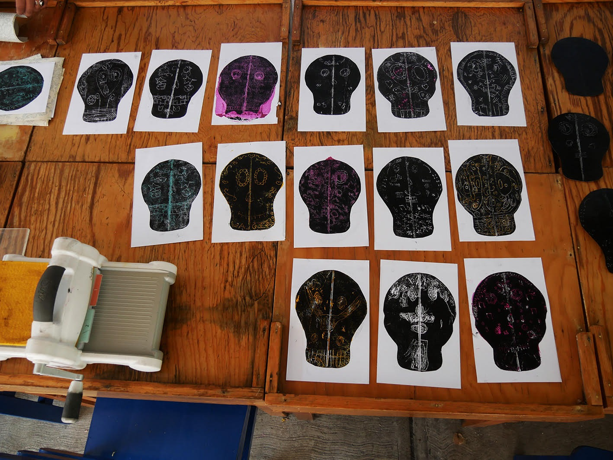
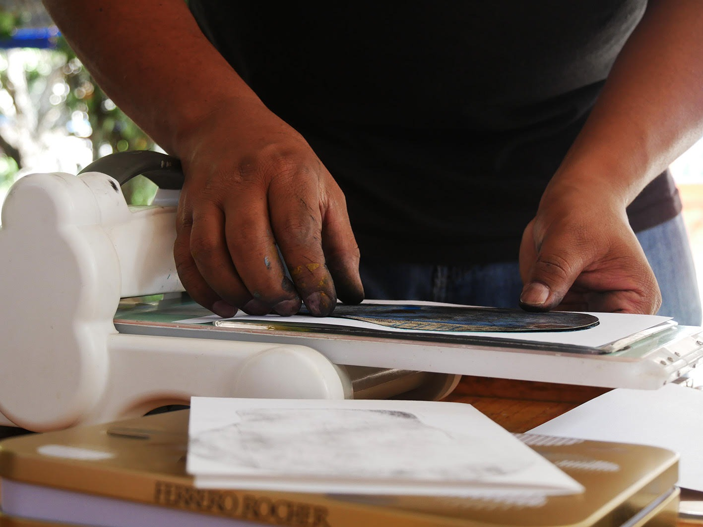
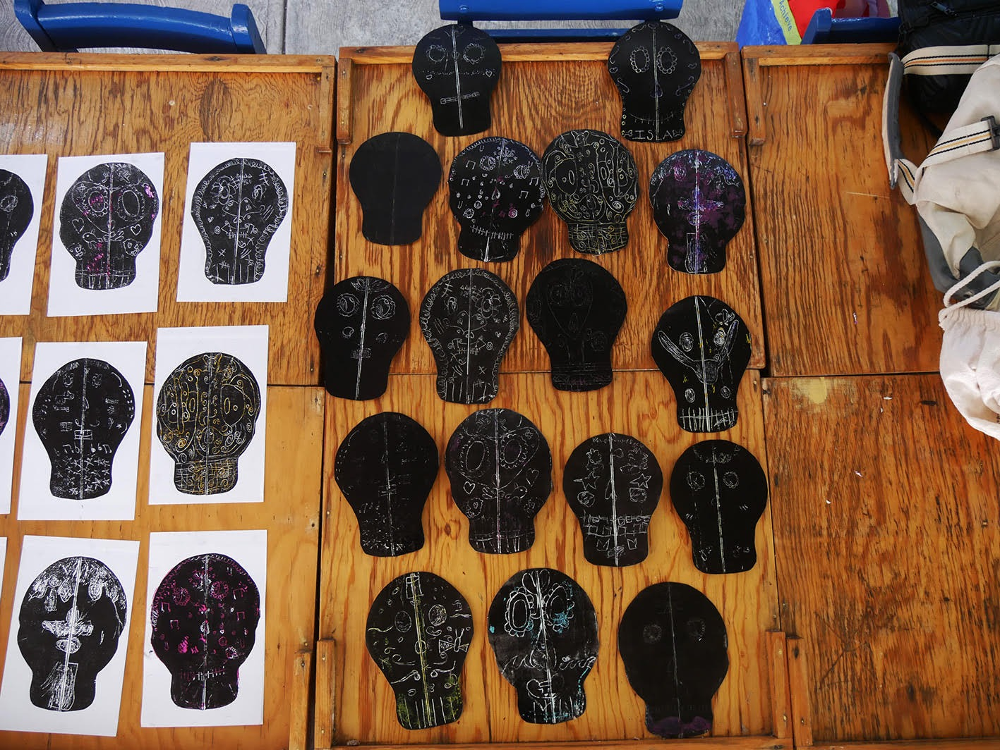
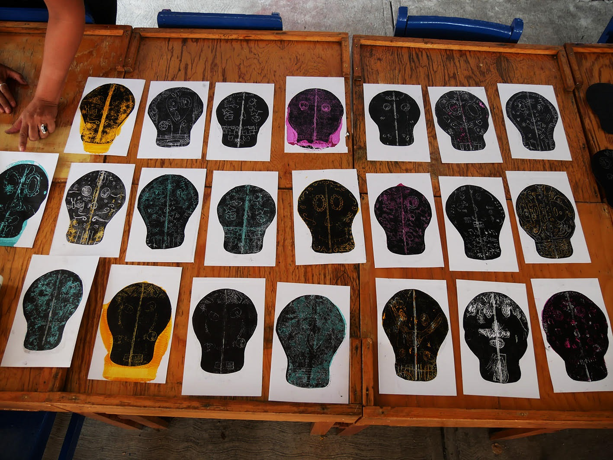
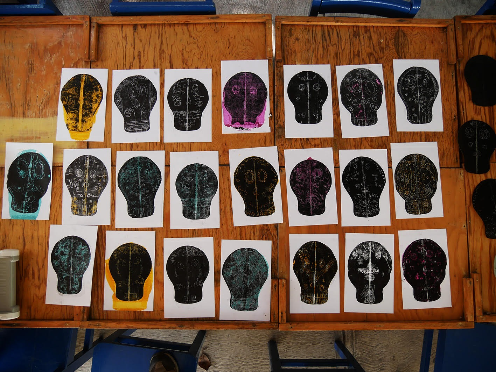
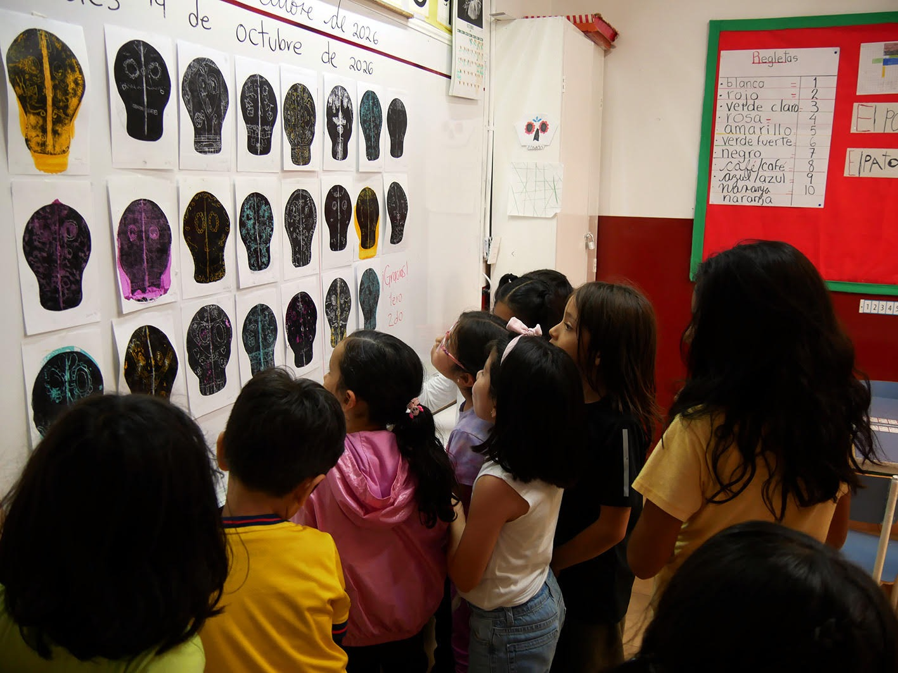
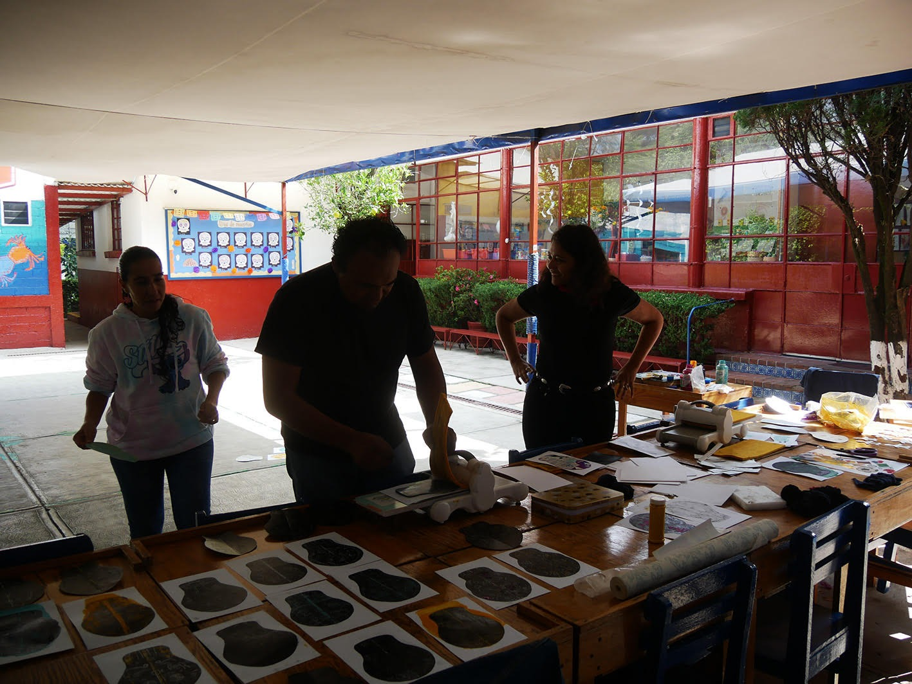
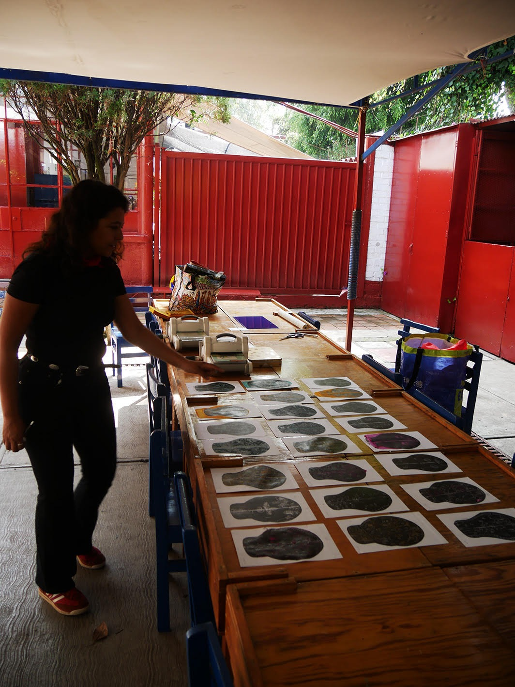
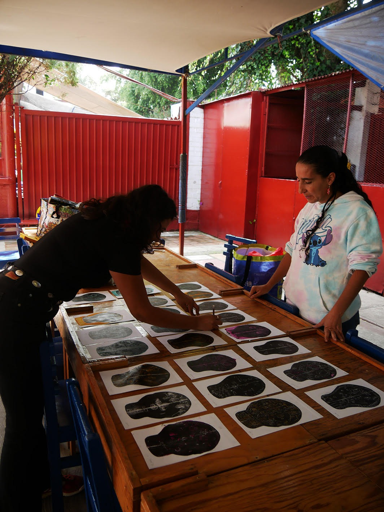
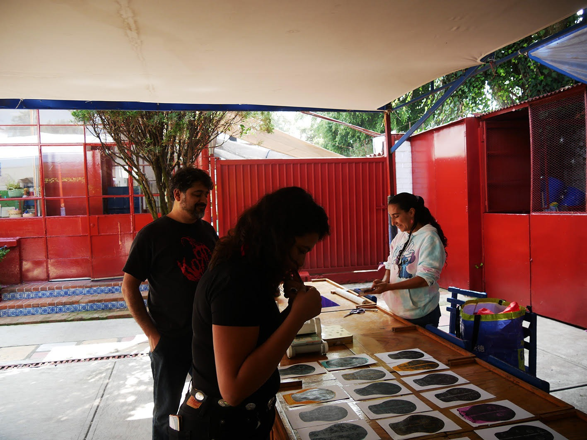

Durante la semana de la ofrenda, el grupo de primero y segundo grado hizo un taller de grabado en dos sesiones. El tema fue el *Tzompantli*, y la propuesta, entender a través del arte una cultura que sigue viva: el Día de Muertos.

## Un muro, muchas semillas

Solemos imaginar el Tzompantli como un muro de cráneos. En el taller lo miramos de otra manera: como un **muro de semillas**, necesarias para la renovación. Las investigaciones arqueológicas más recientes lo interpretan así, y desde ahí el taller abordó la dualidad mesoamericana: vida y muerte, siembra y cosecha.

Para las culturas mesoamericanas, la muerte era el inicio de un viaje y una manera de conservar el equilibrio. Cada niña y niño grabó un cráneo que fuera, en sus palabras y en sus líneas, una semilla que asegura la continuidad de la vida.

La actividad une tres miradas: la historia, a través de la arqueología; el arte, con el grabado; y la educación emocional, porque recordar y despedir también puede ser algo que sana.

Para acompañar el taller leímos *El viaje a Mictlán*.

## Cómo lo hicimos

Las placas de grabado se hicieron con materiales reciclados, como el tetrapack. Algunas de las tintas que usamos eran de avena con miel.

Cada quien dibujó, talló y estampó su propio diseño. Después hubo que entintar, presionar y esperar a ver qué había quedado en el papel.

## Muchas manos, una sola obra

Cada diseño es distinto: unos llevan ojos grandes, otros flores, corazones o líneas que se cruzan. Pero al poner las impresiones una junto a otra, algo cambia. Los cráneos individuales forman un solo muro y las creaciones de cada quien dialogan con las de los demás.

## Los alumnos opinan

Esto fue lo que nos contaron al terminar.

> Me gustó todo lo que hicimos. Gracias.
>
> — Ian

> Me gustó la calaca y el cráneo.
>
> — Iktan

> Me gustó hacer el cráneo y la calaca y escribir.
>
> — Dana

> Fue muy divertido estar con ustedes y mis amigos e hice muchas cosas.
>
> — Juno

> Me gustó hacer el muñeco y también me gustó hacer la calavera.
>
> — Ale

> Me gustó el mecate de mi calavera y cómo quedó.
>
> — Darío

> Me gustó mi Tzompantli y mi calaca chiquita. Me encantaron las actividades.
>
> — Erik

> Me gustó cuando hicimos las calaveritas y los cráneos.
>
> — Ema

> A mí me gustó hacer el cráneo y le puse ojos, nariz, boca, corazones.
>
> — Irene

> Me gustó hacer el cráneo, también la calaca, y ya.
>
> — Matias

> Me gustó hacer las calaveritas y también me gustó el cuento.
>
> — Luna

> Me gustó el cráneo, calaca, calavera.
>
> — Julen

> Me gustó hacer las calaveritas y los cráneos y le puse una flor.
>
> — Nahui

> Me gustó hacer las calaveritas, el cráneo y hacer líneas.
>
> — Ilai

## Para volver a mirarlo

Puedes consultar la [presentación del taller](https://canva.link/h76vu3p5tnolq7n) para ver más de lo que se hizo.
