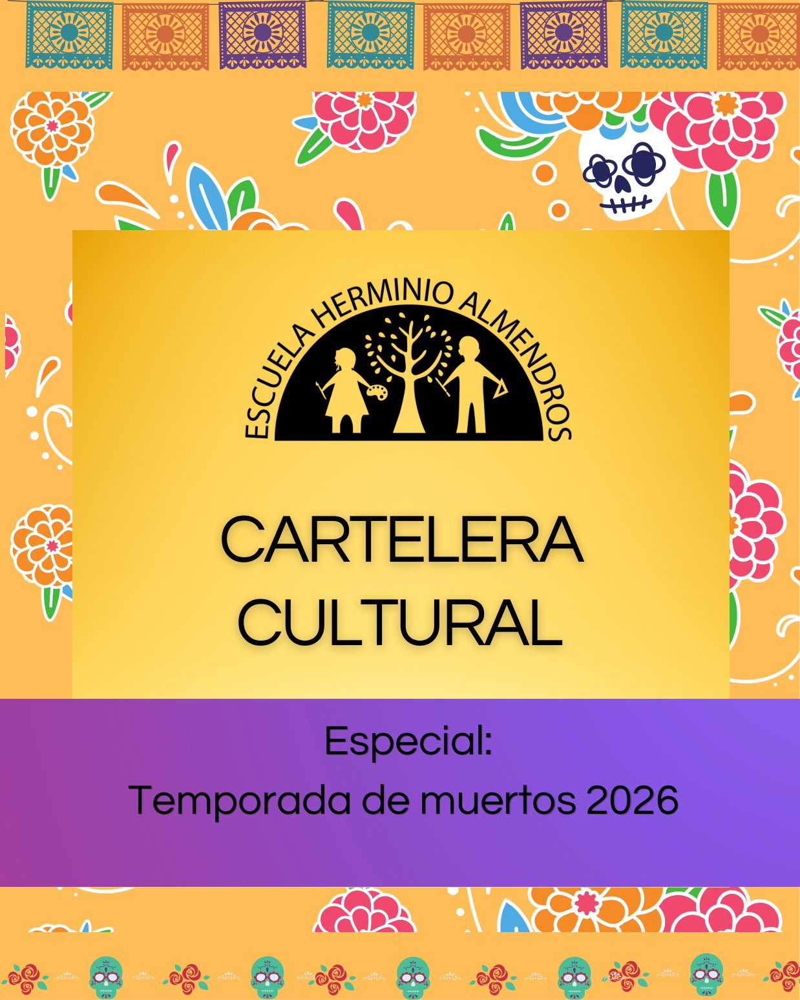

Esta temporada la cartelera del comité se viste de cempasúchil. Reunimos obras, conciertos, talleres y festivales para recordar a nuestros muertos, del sábado 24 de octubre al lunes 2 de noviembre. La mayoría son de entrada libre.

## Teatro

- **[Leyendas tradicionales](/cartelera/leyendas-tradicionales/)**. Estudiantes de la Escuela Nacional de Arte Teatral narran leyendas de nuestra cultura. *Miércoles 28 de octubre · 18:30 h · Museo Casa Estudio Diego Rivera y Frida Kahlo · Entrada libre · Desde 6 años.*

## Danza

- **[Kaguya: la niña que nació de un tallo de bambú](/cartelera/kaguya/)**. Narración oral, danza y música sobre el relato más antiguo de la literatura japonesa. *Sábado 31 de octubre · 12:00 h · Teatro Raúl Flores Canelo, Cenart · Entrada libre · Desde 6 años.*
- **[En México la muerte se baila y se canta](/cartelera/en-mexico-la-muerte-se-baila-y-se-canta/)**. El Ballet Folklórico de México de Amalia Hernández baila el Día de Muertos. *Sábado 31 de octubre · 13:00 h · Pabellón Escénico, Bosque de Chapultepec · Entrada libre, con boleto de acceso.*
- **[El camino del colibrí](/cartelera/el-camino-del-colibri/)**. Danza, circo y música en vivo para contar el viaje de Huitzilin hacia el Mictlán. *Sábado 31 de octubre, 15:00 h, y domingo 1 de noviembre, 16:00 h · Teatro Raúl Flores Canelo, Cenart · Entrada libre · Desde 6 años.*

## Música

- **[Música y matraca para la calaca](/cartelera/musica-y-matraca-para-la-calaca/)**. Valentina Barrios y Los Indómitos, con narración oral, música en vivo y tradiciones mexicanas. *Sábado 31 de octubre · 13:00 h · Centro Cultural Bella Época · Entrada libre, con boleto por correo.*
- **[XXVI Feria de las Calacas](/cartelera/feria-de-las-calacas/)**. Trece grupos en el escenario principal de la fiesta de Alas y Raíces. *Sábado 31 de octubre y domingo 1 de noviembre · Desde las 11:00 h · Áreas verdes del Cenart · Entrada libre.*

## Talleres

- **[Camino al Mictlán](/cartelera/camino-al-mictlan/)**. Visita guiada por la sala Mexica y taller para hacer una bolsa, una vela de cráneo o un ajolote. *Sábado 24 de octubre · 11:30 h · Museo Nacional de Antropología · $100 a $150.*
- **[Crea tu propio papel picado](/cartelera/crea-tu-propio-papel-picado/)**. Diseña y recorta tu propia pieza de papel picado. *Sábados 24 y 31 de octubre · 12:00 h · Calzada Juventud Heroica, Chapultepec · Entrada libre.*
- **[Talleres de Día de Muertos: altares pop-up](/cartelera/altares-pop-up/)**. Altares portátiles para decorar la ofrenda en casa. *Domingo 25 de octubre · 10:00 a 15:00 h · Museo del Caracol · Entrada libre · Desde 9 años.*
- **[Minicatrinas del Bosque](/cartelera/minicatrinas-del-bosque/)**. Figuras artesanales de minicatrinas; conviene llegar temprano. *Domingo 25 de octubre · 12:00 h · Calzada Juventud Heroica, Chapultepec · Entrada libre.*
- **[¡No me olvides!](/cartelera/no-me-olvides/)**. Charla y taller para decorar una máscara de papel. *Domingo 1 de noviembre · 12:30 a 15:00 h · Museo del Caracol · Entrada libre · Desde 9 años.*

## Festivales

- **[Aromas y sabores en los altares de Santa Rosa Xochiac](/cartelera/aromas-y-sabores-de-santa-rosa-xochiac/)**. Una ofrenda de la Sierra de las Cruces en el patio del museo. *Del 25 de octubre al 1 de noviembre · Inauguración a las 12:00 h · Museo Nacional de Antropología.*
- **[La Catrina en cuerpo y color](/cartelera/la-catrina-en-cuerpo-y-color/)**. Una pasarela de catrinas con textiles e indumentaria tradicional. *Jueves 29 de octubre · 13:00 h · Museo Nacional de Culturas Populares · Entrada libre.*
- **[Festival Cacao para Todos 2026](/cartelera/festival-cacao-para-todos/)**. Chocolate, bebidas tradicionales, talleres y música en vivo. *Del 29 de octubre al 2 de noviembre · 10:00 a 19:00 h · Museo Anahuacalli · Entrada libre a la expoventa.*
- **[Gran Desfile de Día de Muertos 2026](/cartelera/gran-desfile-de-dia-de-muertos/)**. Marionetas monumentales, mojigangas y carros alegóricos. *Sábado 31 de octubre · 14:00 h · De la Diana Cazadora al Zócalo.*

## Para buscar más

Estas páginas tienen más exposiciones, talleres y eventos para la temporada:

- [Cartelera de la CDMX](https://cartelera.cdmx.gob.mx/)
- [México es Cultura](https://www.mexicoescultura.com/)
- [Sistema Nacional de Fomento Musical](https://fomentomusical.cultura.gob.mx/)
- [Cartelera del INBAL](https://inba.gob.mx/cartelera)

## ¿Participas en un evento cultural?

La cartelera también es de la comunidad. Si tú o tu familia participan en una presentación, una exposición, una obra, un concierto o cualquier actividad cultural y quieren compartirla, escríbannos con los datos del evento a [comiteculturaherminioalmendros@gmail.com](mailto:comiteculturaherminioalmendros@gmail.com).
