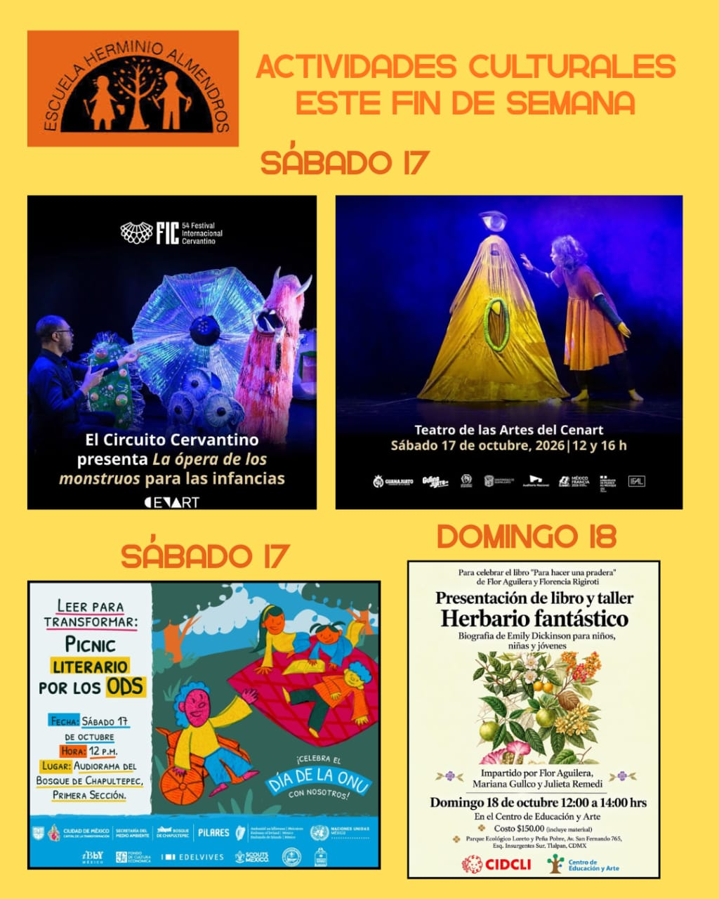

Esta cartelera reúne lo que trae el [Boletín Cultural de octubre](/boletines/la-cultura-es-un-derecho/), más los planes que ya habíamos compartido para el fin de semana del 17 y 18. Las actividades que ya pasaron se quedan como registro del mes.

## Cine

- **[Ambulantito: Caleidoscopia](/cartelera/ambulantito-caleidoscopia/)**. Seis cortometrajes de Ambulantito sobre las muchas maneras de ser, querer y crecer. *Sábado 3 de octubre · 12:00 h · Cine Villa Olímpica.*
- **[Nausicaä del Valle del Viento](/cartelera/nausicaa-del-valle-del-viento/)**. Función gratuita del clásico de Hayao Miyazaki en el Cine Chalana. *Lunes 5 de octubre · 15:00 h · Cine Chalana, colonia Guerrero · Entrada libre.*
- **[Mácula y su oráculo](/cartelera/macula-y-su-oraculo/)**. Función del documental de Mariana X. Rivera con una mediación guiada por su directora. *Viernes 16 de octubre · 18:00 h · Casa de la Cultura UAEMéx, Tlalpan · Entrada libre.*
- **[Los sueños que compartimos](/cartelera/los-suenos-que-compartimos/)**. Un documental que imagina un 2050 donde despertamos al cuidado de la vida. *En cartelera en octubre · Cineteca Nacional Xoco.*
- **[Mary y Max](/cartelera/mary-y-max/)**. La primera película de Adam Elliot llega por primera vez a los cines de México. *En cartelera en octubre · Cinépolis Sala de Arte y Cineteca Nacional.*
- **[Tu nombre (Kimi no na wa)](/cartelera/tu-nombre/)**. Reestreno por sus diez años de la película de anime de Makoto Shinkai. *Desde el 8 de octubre · Cinépolis.*
- **[Un reino para todos nosotros](/cartelera/un-reino-para-todos-nosotros/)**. Una película mexicana de animación sobre la migración. *En cartelera en octubre · Cinemex.*

## Artes plásticas

- **[Mini Domingo: América es la cuestión](/cartelera/mini-domingo-america-es-la-cuestion/)**. Dibujo, pintura y un fanzine para preguntarse qué es «América» y qué es lo «americano». *Domingos 4 y 11 de octubre · 13:00 h · Museo Jumex.*
- **[Mini Domingo: Lo que crece entre las vías](/cartelera/mini-domingo-lo-que-crece-entre-las-vias/)**. Un recorrido por el museo y una caminata por el parque lineal para mirar el paisaje. *Domingo 18 de octubre · 13:00 h · Museo Jumex.*
- **[La imaginación como tecnología](/cartelera/la-imaginacion-como-tecnologia/)**. Segunda sesión de un taller para imaginar refugios para los animales del Bosque de Chapultepec. *Viernes 30 de octubre · 11:00 a 13:00 h · Centro de Cultura Digital · Entrada libre, con registro.*
- **[Viernecitos en el MUAC](/cartelera/viernecitos-en-el-muac/)**. Recorridos y talleres de arte contemporáneo para niñas y niños de 6 a 11 años. *Viernes 30 de octubre · 10:00 a 14:00 h · Ágora del MUAC, CU.*
- **[Taller de impresión de stickers](/cartelera/taller-de-impresion-de-stickers/)**. Aprende, diseña e imprime tus propios stickers en San Ildefonso. *Sábados y domingos de octubre · 11:00 a 14:00 h · Antiguo Colegio de San Ildefonso · $30.*

## Música

- **[Festival del Tambor y Culturas Africanas](/cartelera/festival-del-tambor-y-culturas-africanas/)**. Música, danza, artes y gastronomía de raíz africana en las áreas verdes del Cenart. *Sábado 3 y domingo 4 de octubre · 10:00 a 19:00 h · Áreas verdes del Cenart · Entrada libre.*
- **[Maravillas del clasicismo](/cartelera/maravillas-del-clasicismo/)**. La Orquesta de Cámara de Bellas Artes, con la fagotista Sofía Haydée Almanza como solista. *Jueves 1 y domingo 4 de octubre · Bellas Artes y Jardín Escénico.*
- **[Orquesta Intercultural de Vancouver](/cartelera/orquesta-intercultural-de-vancouver/)**. Una orquesta que reúne instrumentos y tradiciones de todo el mundo, en el Festival CulturaUNAM. *Sábado 10 de octubre · 18:00 a 19:15 h · Sala Carlos Chávez, CCU · Entrada libre.*
- **[Festival Música Contra el Olvido](/cartelera/musica-contra-el-olvido/)**. Dos días de rock alternativo, pop y ritmos latinoamericanos por el Día Internacional de la Música. *Sábado 10 y domingo 11 de octubre · Sala Miguel Covarrubias, CCU.*
- **[Concierto coral Texas Tech](/cartelera/concierto-coral-texas-tech/)**. El coro de la Universidad de Texas Tech canta en el Auditorio Blas Galindo del Cenart. *Domingo 25 de octubre · 13:30 h · Auditorio Blas Galindo, Cenart · Entrada libre.*

## Teatro

- **[Salvaje](/cartelera/salvaje/)**. Teatro, danza, títeres y máscaras sobre crecer, para preadolescentes. *Sábados y domingos, hasta el 4 de octubre · Teatro Milán.*
- **[Tonter I.A.](/cartelera/tonter-ia/)**. Tres clowns, música en vivo y videomapping para reírse de la inteligencia artificial. *Sábados y domingos · 13:00 h, hasta el 4 de octubre · El Gallinero, Centro Cultural del Bosque.*
- **[Pájaro](/cartelera/pajaro/)**. Dos hombres que, inspirados por una mosca, deciden conquistar el cielo. *Sábados y domingos · 13:00 h, del 3 al 11 de octubre · La Titería, Coyoacán.*
- **[La ópera de los monstruos](/cartelera/la-opera-de-los-monstruos/)**. Títeres gigantes, danza y música en vivo para que las infancias se asomen al mundo de la ópera. *Sábado 17 de octubre · 12:00 y 16:00 h · Teatro de las Artes, Cenart · $180.*
- **[PUM](/cartelera/pum/)**. Una payasa pierde el tren y encuentra una maleta llena de historias. 13.º Encuentro Internacional de Clown. *Domingo 18 de octubre · 13:00 h · Teatro Helénico.*
- **[La vendedora de nubes](/cartelera/la-vendedora-de-nubes/)**. Una niña intenta vender una nube en el mercado. Basada en el cuento de Elena Poniatowska. *Del 17 de octubre al 1 de noviembre · 13:00 h · Foro La Gruta, Centro Cultural Helénico.*

## Danza

- **[Rozéo. La oscilación del paisaje](/cartelera/rozeo-la-oscilacion-del-paisaje/)**. Un ballet flotante de la compañía Gratte Ciel en la explanada de La Espiga. *Sábado 10 y domingo 11 de octubre · 13:00 y 18:00 h · Explanada de La Espiga, CCU · Entrada libre.*
- **[Pertene-ser](/cartelera/pertene-ser/)**. Circo contemporáneo, danza y acrobacia del Colectivo Ajolote en Tlalpan. *Sábado 24 de octubre · 19:00 h · Foro Karpa de Mente, Tlalpan · Cooperación voluntaria.*

## Ciencia

- **[Astronomía a la mexicana](/cartelera/astronomia-a-la-mexicana/)**. De los eclipses prehispánicos a los agujeros negros: lo que México ha aportado a la astronomía. *Sábado 3 de octubre · 15:00 h · Museo de Historia Natural.*
- **[Mujeres en la herpetología](/cartelera/mujeres-en-la-herpetologia/)**. Presentación del libro con 50 historias de mujeres que estudian anfibios y reptiles. *Domingo 4 de octubre · 13:30 h · Pabellón Nacional de la Biodiversidad, CU · Entrada libre.*
- **[Semana Mundial del Espacio](/cartelera/semana-mundial-del-espacio/)**. Actividades en varias sedes de la ciudad para celebrar lo que nos ha dado la exploración espacial. *Del 4 al 10 de octubre · Varias sedes de la CDMX.*
- **[Luz y fotografía](/cartelera/luz-y-fotografia/)**. Un taller de divulgación sobre el papel de la luz cuando una cámara hace clic. *Domingo 11 de octubre · 13:00 a 15:00 h · Museo de Historia Natural.*
- **[Maullidos panterosos](/cartelera/maullidos-panterosos/)**. Un taller para hacer separadores y aprender sobre los gatos negros. *Sábados 10 y 17 de octubre · 13:00 a 15:00 h · Museo de Historia Natural.*
- **[Noche de murciélagos](/cartelera/noche-de-murcielagos/)**. Monitoreo de murciélagos y juegos al anochecer en el Ajusco. *Viernes 23 de octubre · 17:30 a 21:00 h · CEA Ecoguardas, Tlalpan · $83 por persona.*
- **[Pajareando ando](/cartelera/pajareando-ando/)**. Un rally por las salas del museo para aprender sobre la biodiversidad de las aves. *Domingos 11, 18 y 25 de octubre · 11:00 a 15:00 h · Museo de Historia Natural.*

## Libros

- **[Herbario fantástico: presentación de libro y taller](/cartelera/herbario-fantastico/)**. Presentación de libro y taller sobre Emily Dickinson, para niñas, niños y jóvenes. *Domingo 18 de octubre · 12:00 a 14:00 h · Centro de Educación y Arte, Tlalpan · $150, material incluido.*

## Salir a descubrir

- **[Leer para transformar: picnic literario por los ODS](/cartelera/picnic-literario-por-los-ods/)**. Un picnic para leer al aire libre y celebrar el Día de la ONU en Chapultepec. *Sábado 17 de octubre · 12:00 h · Audiorama del Bosque de Chapultepec.*

## Día de Muertos

Toda la temporada, con teatro, danza, música, talleres y festivales, está en el [especial de temporada de muertos](/cartelera/especial-dia-de-muertos-2026/).

- **[XXVI Feria de las Calacas](/cartelera/feria-de-las-calacas/)**. La fiesta de Día de Muertos de Alas y Raíces, con arte, tradición y juego para toda la familia. *31 de octubre y 1 de noviembre · 11:00 a 21:00 h · Cenart y Pabellón de Cultura Comunitaria · Entrada libre.*

## ¿Participas en un evento cultural?

La cartelera también es de la comunidad. Si tú o tu familia participan en una presentación, una exposición, una obra, un concierto o cualquier actividad cultural y quieren compartirla, escríbannos con los datos del evento a [comiteculturaherminioalmendros@gmail.com](mailto:comiteculturaherminioalmendros@gmail.com).
