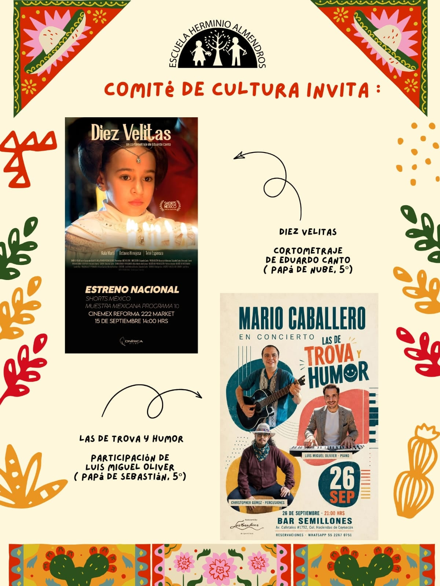

## Martes 15 de septiembre

### Diez Velitas

Cortometraje de Eduardo Canto, papá de la comunidad de 5.º. Estreno nacional en Shorts México, Muestra Mexicana, programa 10.

- **Cuándo:** martes 15 de septiembre de 2026, a las 14:00 h
- **Dónde:** Cinemex Reforma 222 Market

## Sábado 26 de septiembre

### Mario Caballero en concierto: Las de trova y humor

Con la participación de Luis Miguel Olivier, papá de la comunidad de 5.º, en el piano, y Christopher Gómez en las percusiones.

- **Cuándo:** sábado 26 de septiembre de 2026, a las 21:00 h
- **Dónde:** Bar Semillones, Av. Cafetales 1752, Col. Haciendas de Coyoacán

## ¿Participas en un evento cultural?

La cartelera también es de la comunidad. Si tú o tu familia participan en una presentación, una exposición, una obra, un concierto o cualquier actividad cultural y quieren compartirla, escríbannos con los datos del evento a [comiteculturaherminioalmendros@gmail.com](mailto:comiteculturaherminioalmendros@gmail.com).
