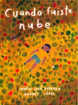

- **Libro:** *Cuando fuiste nube*, de María José Ferrada y Andrés López (Fondo de Cultura Económica, 2019). Premio Hispanoamericano de Poesía para Niños 2018.
- **Recomienda:** Tatiana C., mamá de Rodrigo, de 4.º

## La reseña

¿Crees que las palabras se pueden sentir?, ¿oler?, ¿tocar? ¿Alguna vez has leído un libro de poesía? *Cuando fuiste nube* es un libro de poesía para niñas y niños muy bello, que invoca la imaginación, el lenguaje y los sentidos.

En él te encontrarás con montañas que despiertan cada cien o doscientos años, astronautas que van a los parques y caballos que galopan sobre la mesa entre el pan y la miel. Tú también puedes encontrarte con cosas maravillosas dentro de tu casa: ¡sólo hay que mirar muy bien! Este libro trata de viajes, del otoño, del árbol que entra en tu casa y del espacio que une el cielo y el mar. Pero también habla del día en que, antes de ser tú, fuiste nube.

Es una invitación a crear y a tocar el mundo con el lenguaje: «inventa un idioma: palabras como trébol, azúcar, zanahoria». Explora el lenguaje, sus dimensiones y su capacidad creativa y sensorial, porque las «consonantes crujen como hojas secas». No te pierdas la experiencia de sentir cómo las palabras explotan como burbujas dentro de tu boca y cómo, al abrirla, pueden salir flotando… ¡como una nube!

¿Tú también quieres recomendar un libro? [Así puedes enviar tu reseña](/lecturas/lecturas-de-la-comunidad/#recomienda).
