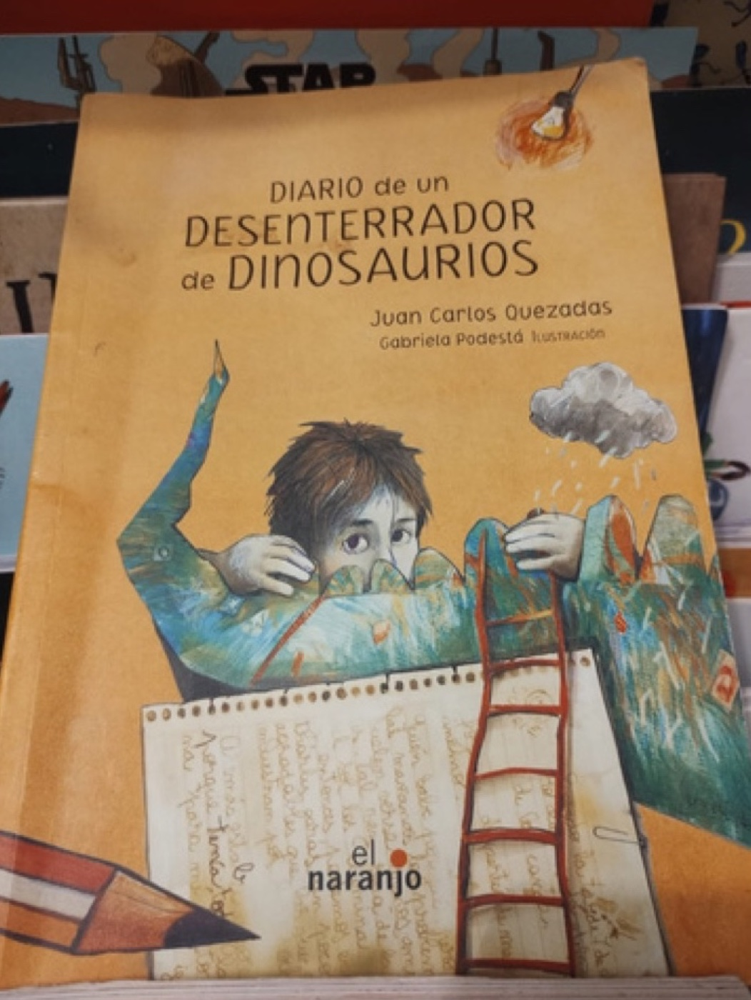

- **Libro:** *Diario de un desenterrador de dinosaurios*, de Juan Carlos Quezadas, con ilustraciones de Gabriela Podestá (El Naranjo, 2014)
- **Recomienda:** Lucía R., de 4º

## La reseña

Recomiendo *El desenterrador de dinosaurios*. Lo recomiendo mucho porque es muy divertido y, si estás de vacaciones, es muy bueno para leer de día y de noche. Y también siento que es para todas las edades porque es imaginativo y para todo tipo de gustos. Mi mamá también se divertía leyéndome.

¿Tú también quieres recomendar un libro? [Así puedes enviar tu reseña](/lecturas/lecturas-de-la-comunidad/#recomienda).
