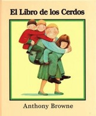

- **Libro:** *El libro de los cerdos*, de Anthony Browne (Fondo de Cultura Económica, colección Los Especiales de A la Orilla del Viento, varias ediciones)
- **Recomienda:** Tatiana C., mamá de Rodrigo, de 4.º

## La reseña

Estamos seguros de que ya has leído alguna historia de Anthony Browne, pero quizá ésta todavía no. *El libro de los cerdos* aborda el tema de los cuidados y de los roles de género, es decir, la idea de que hay actividades exclusivas según si eres mujer u hombre, niña o niño. El autor lo trata de una manera sencilla y muy amena.

A partir de la vida cotidiana de la familia De la Cerda, invita a reflexionar sobre quién debe hacer el trabajo del hogar y de cuidados, y sobre los roles de género, que no son reglas fijas, sino culturales. O sea, que podemos aprenderlos y cambiarlos. También invita a toda la familia a participar en el trabajo de cuidados para convivir mejor, en beneficio de todos sus integrantes, incluyendo, por supuesto, a la mamá.

Las ilustraciones son muy atractivas y graciosas. Te invitamos a leerlo y a cuestionar elementos sociales y culturales que antes se veían como «naturales». Si lo lees, ¿nos cuentas qué te pareció?

¿Tú también quieres recomendar un libro? [Así puedes enviar tu reseña](/lecturas/lecturas-de-la-comunidad/#recomienda).
