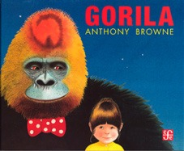

- **Libro:** *Gorila*, de Anthony Browne (Fondo de Cultura Económica, varias ediciones)
- **Recomienda:** Rodrigo Emilio, de 4.º

## La reseña

Recomiendo este libro porque es muy bonito y sentimental. El libro trata de una niña y su papá, y de cuando los papás no tienen tiempo porque tienen que trabajar y no te pueden llevar a todos los lugares que te gustan ni hacer contigo cosas divertidas, y tienes que ver la tele o hacer cosas tú solo.

El final es muy bonito porque el papá le pone atención a su hija, lo cual es fundamental para cualquier niño o niña. ¡Ojalá te guste!

¿Tú también quieres recomendar un libro? [Así puedes enviar tu reseña](/lecturas/lecturas-de-la-comunidad/#recomienda).
