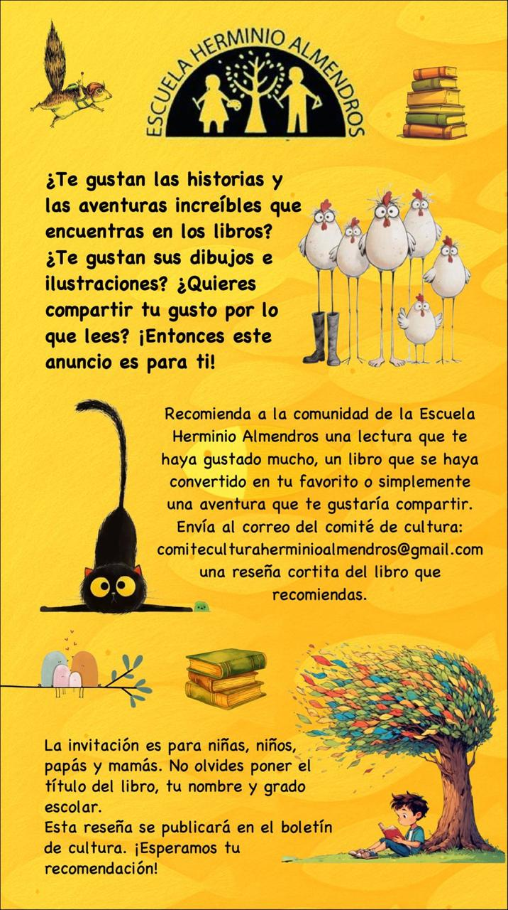

<h2 id="alumnado">Voces del alumnado</h2>

Lo que sorprendió, lo que hizo reír, la pregunta que quedó abierta. Leer también es encontrar una manera propia de contar lo que sentimos.

- [*Gorila*](/lecturas/gorila/), de Anthony Browne. Lo recomienda Rodrigo Emilio, de 4º: «Es muy bonito y sentimental».

<h2 id="adultos">Lecturas de personas adultas</h2>

Un libro que queremos compartir. Una historia que invita a otra conversación. Las recomendaciones de personas adultas acompañan las voces del alumnado y amplían las miradas sobre cada lectura.

- [*El libro de los cerdos*](/lecturas/el-libro-de-los-cerdos/), de Anthony Browne. Lo recomienda Tatiana C., mamá de Rodrigo, de 4º: una invitación a preguntarnos quién hace el trabajo de la casa.
- [*Cuando fuiste nube*](/lecturas/cuando-fuiste-nube/), de María José Ferrada y Andrés López. También lo recomienda Tatiana C.: un libro de poesía para sentir, oler y tocar las palabras.

<h2 id="recomienda">Recomienda un libro</h2>

¿Te gustan las historias y las aventuras increíbles que encuentras en los libros? ¿Te gustan sus dibujos e ilustraciones? ¿Quieres compartir tu gusto por lo que lees?

Recomienda a la comunidad de la Escuela Herminio Almendros una lectura que te haya gustado mucho, un libro que se haya convertido en tu favorito o simplemente una aventura que te gustaría compartir.

Envía una reseña cortita del libro que recomiendas a [comiteculturaherminioalmendros@gmail.com](mailto:comiteculturaherminioalmendros@gmail.com).

- La invitación es para niñas, niños, papás y mamás.
- No olvides poner el **título del libro**, tu **nombre** y tu **grado escolar**.
- Tu reseña se publicará en el boletín de cultura.

¿No sabes por dónde empezar? Mira [una reseña de ejemplo](/lecturas/para-hacer-una-pradera/) sobre *Para hacer una pradera*.

