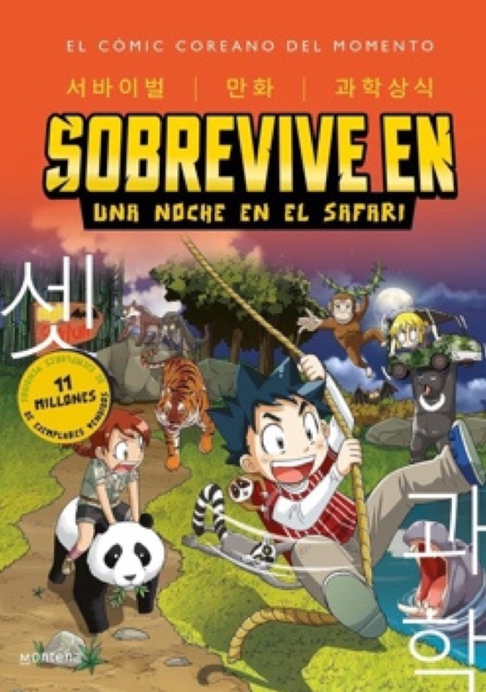

- **Libro:** *Sobrevive en: Una noche en el safari*, de Gomdori Co. y Han Hyun-dong (Montena, 2023), traducción de Ainhoa Urquiza y Álvaro Trigo
- **Recomienda:** Darío V., de 2º

## La reseña

Les recomiendo una serie de libros que me gusta mucho. Se los recomiendo porque a mí me gustan los cómics y estos son mangas, y a mí me gustan los dibujos de los mangas. Son tres libros, pero mi favorito se llama *Sobrevive en: Una noche en el safari*.

Tiene un buen guion. Les advierto que hay cosas que no se entienden porque algunas expresiones están en coreano.

El personaje principal se llama Jio y tiene un amigo que se llama Kay. Lo que más me gustó es la parte donde salen los lobos y los empiezan a asustar. Es bonito y aprendes mucho sobre animales.

Los otros dos libros de la serie son *Sobrevive en: El museo prehistórico* y *Sobrevive en: El mundo submarino*.

¿Tú también quieres recomendar un libro? [Así puedes enviar tu reseña](/lecturas/lecturas-de-la-comunidad/#recomienda).
